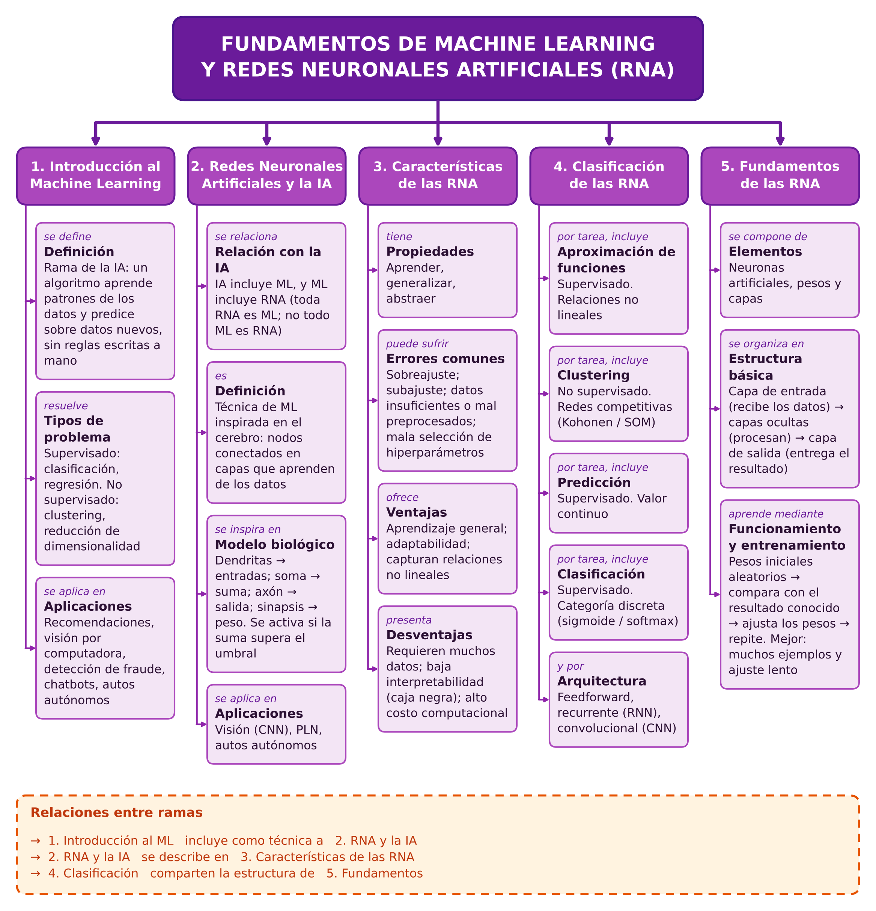
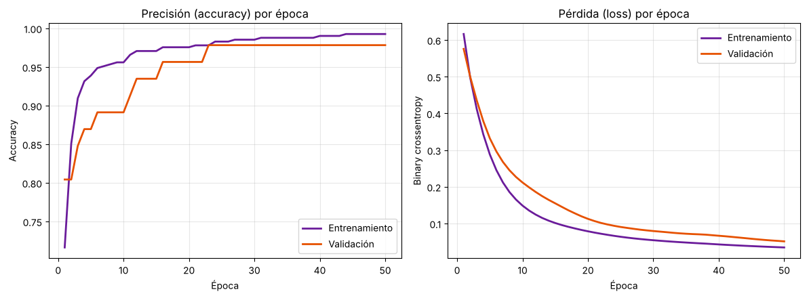

# 🛠️ Actividad Integradora 1 — Fundamentos de Machine Learning I

**Asignatura:** Fundamentos de Machine Learning · **Trimestre:** T3 — 2026 | Semana 5 · **Cubre:** UD1–UD5
**Autor:** Fredys Agustin Caballero Soto — Maestría en Ciencia de Datos, Universidad DaVinci

---

## 🎯 Objetivo

Comprender y aplicar los fundamentos de Machine Learning a través de un **mapa conceptual** y la **implementación práctica de una red neuronal artificial** en Python.

## 📦 Contenido de la carpeta

| Archivo | Qué es |
|---|---|
| `Tarea1_Mapa_Conceptual.png` / `.svg` | Mapa conceptual (Tarea 1), versión vertical |
| `Tarea2_RNA_Cancer_Mama.ipynb` | Notebook de la Tarea 2, ejecutado, con explicación paso a paso |
| `curvas_entrenamiento.png` | Historia del entrenamiento (precisión y pérdida) |

---

## 🗺️ Tarea 1 — Mapa conceptual

Mapa que integra las 5 ramas pedidas: **Introducción al ML**, **RNA y su relación con la IA**, **Características de las RNA** (errores comunes, ventajas, desventajas), **Clasificación de las RNA** (aproximación de funciones, clustering, predicción, clasificación) y **Fundamentos de las RNA** (elementos y estructura básica).

**Cómo se relacionan las ramas.** El Machine Learning (rama 1) es el punto de partida: permite que un sistema aprenda patrones a partir de datos. Las RNA (rama 2) son una de sus técnicas, inspirada en el cerebro y enmarcada dentro de la IA. Sus características (rama 3) —ventajas, desventajas y errores como el sobreajuste— indican cuándo conviene usarlas. Según la tarea que resuelven, se clasifican (rama 4) en aproximación de funciones, clustering, predicción y clasificación. Todas comparten los elementos y la estructura de la rama 5: neuronas, pesos y capas de entrada, ocultas y salida.

---

## 🧠 Tarea 2 — RNA con Python y Keras

### Objetivo
Entrenar una RNA que clasifique **tumores de mama como malignos o benignos** a partir de 30 medidas numéricas.

### Contexto
Conjunto **Breast Cancer Wisconsin (Diagnostic)** (Wolberg et al., 1995), incluido en scikit-learn: 569 registros, 30 variables, 212 malignos y 357 benignos, sin valores nulos. Problema de clasificación binaria supervisada.

### Qué pide la tarea
Cargar y escalar los datos (80/20), construir un modelo `Sequential` con capas `Dense`, compilarlo con `adam` y `binary_crossentropy`, entrenarlo 50 épocas con 10 % de validación, evaluarlo en prueba y graficar la historia de entrenamiento.

### Resumen ejecutivo
Una red neuronal pequeña (2 capas ocultas de 16 y 8 neuronas con ReLU y una salida sigmoide; **641 parámetros**) clasificó correctamente el **96,49 %** de los pacientes del conjunto de prueba, con una pérdida de **0,0853**.

| Elemento | Detalle |
|---|---|
| Datos | 455 pacientes para entrenar y 114 para probar (división 80/20 estratificada); 10 % del entrenamiento para validación |
| Preprocesamiento | `StandardScaler` ajustado solo con el entrenamiento, para evitar fuga de datos hacia la prueba |
| Entrenamiento | 50 épocas, `adam`, `binary_crossentropy`, `batch_size=32` |
| Resultado en prueba | pérdida **0,0853** · precisión **96,49 %** |

**Matriz de confusión (prueba, 114 pacientes)**

| | Predicho: maligno | Predicho: benigno |
|---|---|---|
| **Real: maligno** | 41 | 1 |
| **Real: benigno** | 3 | 69 |

De 42 tumores malignos, la red detectó 41 (*recall* ≈ 97,6 %); marcó 3 benignos como malignos.

Las curvas de entrenamiento y validación bajan juntas, sin señales claras de sobreajuste.

**Limitación:** con 114 casos de prueba, un solo paciente mueve la precisión cerca de 0,9 puntos; una validación cruzada daría una estimación más estable.

### Notebook
📓 [`Tarea2_RNA_Cancer_Mama.ipynb`](./Tarea2_RNA_Cancer_Mama.ipynb) · [Ver en Google Drive / Colab](https://drive.google.com/file/d/1qdDeoiPBuRmHtKtzUoLkAkNM0WmvU6AA/view?usp=sharing)

---

## 🛠️ Stack

## 📚 Referencias

Scikit-learn developers. (s. f.). *StandardScaler*. https://scikit-learn.org/stable/modules/generated/sklearn.preprocessing.StandardScaler.html

TensorFlow. (s. f.). *The Sequential model*. https://www.tensorflow.org/guide/keras/sequential_model

Wolberg, W. H., Street, W. N., & Mangasarian, O. L. (1995). *Breast Cancer Wisconsin (Diagnostic)* [Conjunto de datos]. UCI Machine Learning Repository. https://archive.ics.uci.edu/dataset/17
