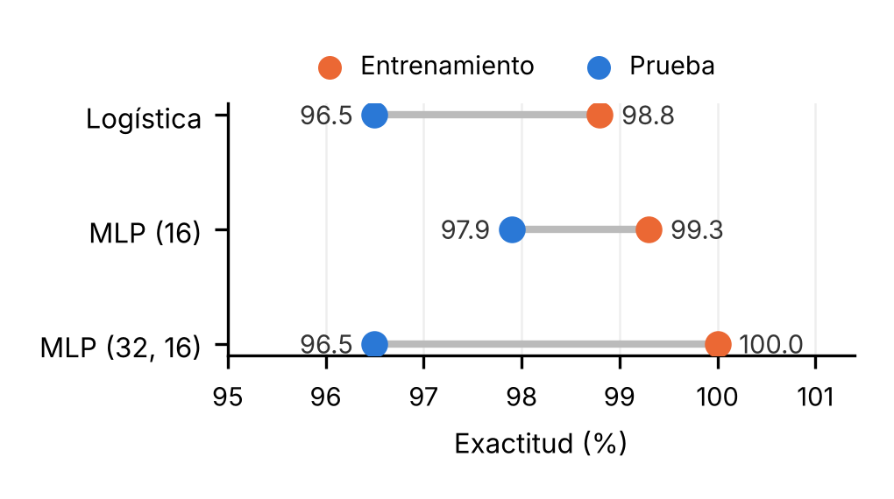

# Actividad Integradora 2 — Artículo científico (Fundamentos de Machine Learning II)

**Asignatura:** Fundamentos de Machine Learning
**Trimestre:** T3 — 2026 | Semana 10
**Cubre:** mecanismos de aprendizaje y topologías de RNA (UD6–UD10); caso aplicado con interpretación de resultados (UD10)
**Norma de citación:** APA 7.ª edición
**Entrega:** artículo de 2 páginas en Word ([`Actividad-Integradora-2-Articulo-Cientifico.docx`](./Actividad-Integradora-2-Articulo-Cientifico.docx)), con la estructura de un artículo científico: título bilingüe, resumen/abstract, introducción, desarrollo, conclusiones y referencias
**Experimento:** [`experimento_cancer_mama.py`](../codigo/experimento_cancer_mama.py) (semilla 42; los números de la Tabla I salen de este script)

**Enunciado:** escribir un artículo científico de 2 a 3 páginas sobre un tema de Machine Learning y redes neuronales artificiales, con título, resumen, introducción, desarrollo (mecanismos de aprendizaje, topologías, ejemplos y estudios de caso), conclusiones y referencias.

> **Nota:** el caso aplicado es un experimento propio y reproducible con datos reales de scikit-learn; no es un estudio clínico.

---

**De los datos a la decisión: mecanismos de aprendizaje y topologías de redes neuronales en el diagnóstico médico**

***From Data to Decision: Learning Mechanisms and Neural Network Topologies in Medical Diagnosis***

Fredys Caballero

Universidad DaVinci

Maestría en Ciencia de Datos (IA/ML)

**Resumen—**El machine learning (ML) transforma datos en información útil para decidir, y en medicina esa decisión puede cambiar un tratamiento. Este artículo revisa los tres mecanismos de aprendizaje (supervisado, no supervisado e híbrido) y dos topologías de redes neuronales artificiales (monocapa y multicapa), y los ilustra con el diagnóstico de cáncer de mama. En un experimento propio con 569 casos se comparan una neurona única (regresión logística) y dos perceptrones multicapa. Los tres modelos alcanzaron un AUC de 0.99 o más, y la red más grande no mejoró: memorizó el entrenamiento. Se concluye que la complejidad debe justificarse con datos nuevos y que, en diagnóstico, importa más no dejar escapar casos malignos que la exactitud global.

**Palabras clave**: machine learning; redes neuronales artificiales; aprendizaje supervisado; diagnóstico médico.

***Abstract—**Machine learning (ML) turns data into useful information for decision-making, and in medicine such decisions can change a treatment. This paper reviews three learning mechanisms (supervised, unsupervised and hybrid) and two artificial neural network topologies (single-layer and multilayer), illustrated with breast cancer diagnosis. In an own experiment with 569 cases, a single neuron (logistic regression) and two multilayer perceptrons are compared. All three models reached an AUC of 0.99 or higher, and the largest network did not improve: it memorized the training data. It is concluded that complexity must be justified with new data and that, in diagnosis, not missing malignant cases matters more than overall accuracy.*

***Keywords**: machine learning; artificial neural networks; supervised learning; medical diagnosis.*

## I. Introducción

Los hospitales generan imágenes, análisis de laboratorio e historias clínicas. Por sí solos son datos; se vuelven información cuando un modelo aprende patrones que ayudan a decidir. Esa es la función central del ML: convertir datos en apoyo para la toma de decisiones (Goodfellow et al., 2016). Su uso en diagnóstico no es nuevo: desde 1990 se aplican métodos de separación de patrones a la citología de mama (Wolberg y Mangasarian, 1990). Lo que cambió es la capacidad de las redes neuronales artificiales (RNA), que hoy sustentan buena parte de los avances de la inteligencia artificial (LeCun et al., 2015).

El objetivo de este artículo es explicar cómo aprenden los modelos, cómo influye la estructura de una RNA en lo que logra, y mostrarlo con un caso de diagnóstico.

## II. Mecanismos de aprendizaje

Según cómo reciben la información, los modelos aprenden de tres formas (Universidad DaVinci, s. f.-b).

### A. Supervisado

El modelo aprende de ejemplos con respuesta conocida. En diagnóstico, cada paciente trae la etiqueta confirmada por biopsia (benigno o maligno) y el modelo aprende a predecirla. Es el mecanismo del caso de este artículo. Un ejemplo a gran escala es el de Esteva et al. (2017): entrenaron una red convolucional profunda con 129,450 imágenes clínicas de 2,032 enfermedades de la piel y, en dos tareas de clasificación con biopsia como referencia, su desempeño fue comparable al de 21 dermatólogos certificados.

### B. No supervisado

No hay etiquetas: el modelo busca estructura por sí solo, por ejemplo agrupando pacientes con perfiles parecidos para detectar subgrupos que nadie definió antes.

### C. Híbrido (semisupervisado)

Combina pocos datos etiquetados con muchos sin etiquetar (Chapelle et al., 2006). Es útil en medicina, donde etiquetar exige a un especialista y es costoso, mientras que los datos sin etiquetar abundan.

## III. Topologías de redes neuronales

La topología es la forma en que se organizan las neuronas en capas (Universidad DaVinci, s. f.-c).

### A. Monocapa

El perceptrón de Rosenblatt (1958) conecta las entradas directamente a la salida. Solo separa clases con una frontera lineal. La regresión logística equivale a una neurona con activación sigmoide, es decir, a esta topología.

### B. Multicapa

El perceptrón multicapa (MLP) agrega una o más capas ocultas entre la entrada y la salida, y se entrena con retropropagación (Goodfellow et al., 2016). Con suficientes neuronas puede aproximar funciones muy complejas (Hornik et al., 1989), pero más capacidad también significa más riesgo de sobreajuste: aprender el ruido del entrenamiento en lugar del patrón general.

## IV. Caso aplicado: diagnóstico de cáncer de mama

### A. Datos y método

Se usó el conjunto Breast Cancer Wisconsin (Diagnostic) incluido en scikit-learn (Pedregosa et al., 2011): 569 pacientes, 30 variables numéricas calculadas a partir de imágenes de aspirado con aguja fina y 37.3 % de casos malignos. Se separó 75 % para entrenar y 25 % (143 casos) para probar, con muestreo estratificado. Se compararon una regresión logística (sin capa oculta), un MLP con una capa oculta de 16 neuronas y un MLP con capas de 32 y 16, todos con variables estandarizadas. Se reportan exactitud, precisión, recall (clase maligna), AUC y Log Loss, medidas que permiten interpretar un clasificador más allá de la exactitud (Saito y Rehmsmeier, 2015; Universidad DaVinci, s. f.-a). Es un experimento propio y reproducible, no un estudio clínico.

### B. Resultados

Tabla I. Desempeño en datos de prueba (n = 143)

| Modelo       | Exact.     | Prec.     | Recall     | AUC     | Log Loss     | FN     |
|--------------|------------|-----------|------------|---------|--------------|--------|
| Logística    | 96.5 %     | 98.0 %    | 92.5 %     | 0.996   | 0.078        | 4      |
| MLP (16)     | 97.9 %     | 100 %     | 94.3 %     | 0.995   | 0.075        | 3      |
| MLP (32, 16) | 96.5 %     | 100 %     | 90.6 %     | 0.991   | 0.158        | 5      |

Fuente: Autores. FN = casos malignos no detectados.

Los tres modelos separan muy bien las clases (AUC ≥ 0.99). El MLP de 16 neuronas fue ligeramente mejor. El MLP (32, 16) acertó 100 % en entrenamiento, pero su Log Loss en prueba fue el doble y dejó pasar más casos malignos (Fig. 1).

Figura 1. Exactitud en entrenamiento y prueba

Fuente: Autores.

### C. Discusión

El problema es casi linealmente separable: la regresión logística, la topología más simple, ya rinde casi igual que las redes. La ventaja del MLP de 16 neuronas es de uno o dos pacientes, y con 143 casos de prueba cada paciente pesa 0.7 puntos; no es concluyente. Lo más claro es el efecto de la complejidad: la red más grande memorizó en lugar de generalizar, la señal clásica de sobreajuste.

En diagnóstico, además, el error no es simétrico. Un falso negativo deja a una paciente enferma sin detectar; un falso positivo lleva a más pruebas. Por eso el recall pesa más que la exactitud, y el umbral de decisión debe definirse con criterios clínicos, no con el valor por defecto de 0.5.

## V. Conclusiones

Los mecanismos de aprendizaje se eligen según los datos disponibles: el supervisado exige etiquetas, el no supervisado explora estructura y el híbrido aprovecha pocas etiquetas con muchos datos sin etiquetar. Una topología más compleja no garantiza mejores resultados: aquí la neurona única y el MLP pequeño rindieron casi igual y la red más grande sobreajustó, por lo que conviene empezar por lo simple y justificar cada capa adicional con datos no vistos. Evaluar un modelo exige más que la exactitud: matriz de confusión, recall, AUC y Log Loss revelan cómo falla y a qué costo.

Los avances en redes profundas (Esteva et al., 2017; LeCun et al., 2015) apuntan a una IA que asista al especialista, no que lo reemplace, y que requiere datos de calidad, validación rigurosa y criterio clínico para usarse con responsabilidad.

## VI. Referencias

Chapelle, O., Schölkopf, B., y Zien, A. (2006). *Semi-supervised learning*. MIT Press.

Esteva, A., Kuprel, B., Novoa, R. A., Ko, J., Swetter, S. M., Blau, H. M., y Thrun, S. (2017). Dermatologist-level classification of skin cancer with deep neural networks. *Nature, 542*(7639), 115–118. https://doi.org/10.1038/nature21056

Goodfellow, I., Bengio, Y., y Courville, A. (2016). *Deep learning*. MIT Press.

Hornik, K., Stinchcombe, M., y White, H. (1989). Multilayer feedforward networks are universal approximators. *Neural Networks, 2*(5), 359–366.

LeCun, Y., Bengio, Y., y Hinton, G. (2015). Deep learning. *Nature, 521*(7553), 436–444. https://doi.org/10.1038/nature14539

Pedregosa, F., Varoquaux, G., Gramfort, A., Michel, V., Thirion, B., Grisel, O., Blondel, M., Prettenhofer, P., Weiss, R., Dubourg, V., Vanderplas, J., Passos, A., Cournapeau, D., Brucher, M., Perrot, M., y Duchesnay, É. (2011). Scikit-learn: Machine learning in Python. *Journal of Machine Learning Research, 12*, 2825–2830.

Rosenblatt, F. (1958). The perceptron: A probabilistic model for information storage and organization in the brain. *Psychological Review, 65*(6), 386–408. https://doi.org/10.1037/h0042519

Saito, T., y Rehmsmeier, M. (2015). The precision-recall plot is more informative than the ROC plot when evaluating binary classifiers on imbalanced datasets. *PLoS ONE, 10*(3), e0118432.

Universidad DaVinci. (s. f.-a). *Unidad 10: Interpretación de resultados* \[Guía de estudio\].

Universidad DaVinci. (s. f.-b). *Unidad 6: Mecanismos de aprendizaje* \[Guía de estudio\].

Universidad DaVinci. (s. f.-c). *Unidad 7: Topologías de las RNA* \[Guía de estudio\].

Wolberg, W. H., y Mangasarian, O. L. (1990). Multisurface method of pattern separation for medical diagnosis applied to breast cytology. *Proceedings of the National Academy of Sciences, 87*(23), 9193–9196. https://doi.org/10.1073/pnas.87.23.9193
