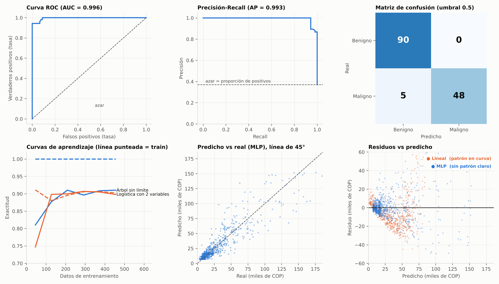

# UD10 · Interpretación de resultados — Fundamentos de Machine Learning (T3)

> **Fuentes:** guía académica de la unidad (13 pp.), Recursos y Bibliografía de la asignatura, Goodfellow et al. (2016) y fuentes verificadas (sección Referencias).
> **Convención:** **[guía]** = sale de la guía · **[complemento]** = fuente externa · **[propio]** = prueba que ejecuté yo.
> **Código:** [`interpretacion_resultados.py`](../codigo/interpretacion_resultados.py) · **Actividad de la semana:** [Artículo científico](../actividades/Actividad-Integradora-2-Articulo-Cientifico.md)
> **Nota:** varios párrafos de la guía se extraen mezclados del PDF; lo dudoso va como **[verificar]**.

---

## 1. Resumen ejecutivo
Entrenar la red no termina el trabajo: hay que saber **si sirve**. La unidad tiene tres partes:
1. **Gráficas:** muestran *dónde* y *cómo* falla el modelo.
2. **Medidas de error:** dicen *cuánto* falla, en un número comparable.
3. **Error aceptable:** decide si ese error es tolerable para el negocio.

Idea central: **un número suelto casi nunca basta.** Se interpreta contra un punto de comparación (benchmark) y con datos que el modelo no vio.

## 2. Fundamentos técnicos

### 2.1 Gráficas de resultados **[guía]**

| Gráfica | Para qué sirve | Cuándo |
|---|---|---|
| Matriz de confusión | Cuenta aciertos y tipos de error: VP, VN, FP, FN | Clasificación |
| Curva ROC y AUC | TPR vs FPR al variar el umbral; AUC = capacidad de separar clases (0.5 azar, 1 perfecto) | Clasificación binaria |
| Curva Precisión-Recall | Precisión vs recall al variar el umbral | Clases desbalanceadas o FP/FN costosos |
| Curva de aprendizaje | Exactitud en entrenamiento y validación según el tamaño de los datos | Diagnosticar sobreajuste y subajuste |
| Dispersión predicho vs real | Si los puntos caen sobre la línea de 45° | Regresión |
| Histograma de residuos | Distribución de (real − predicho) | Regresión |


*Figura: ROC, PR y matriz de confusión (Random Forest, cáncer de mama, datos reales); curvas de aprendizaje; predicho vs real y residuos (montos **simulados**). Se generó con los mismos modelos y semillas del script; el código de dibujo no se incluye.*

**Cómo leer la matriz de confusión de la figura** (Random Forest, maligno = positivo): 90 VN, 0 FP, 5 FN, 48 VP.
- Exactitud = (90 + 48) / 143 = **96.5 %**.
- Precisión = 48 / (48 + 0) = **100 %**: todo lo que marcó maligno lo era.
- Recall = 48 / (48 + 5) = **90.6 %**: se le escaparon 5 malignos. En medicina el error caro es el FN.

**ROC vs PR [complemento]:** la ROC puede verse "bonita" con muy pocos positivos; la curva PR es más exigente porque su línea base es la proporción de positivos (~0.37 en la figura), no 0.5 (Saito & Rehmsmeier, 2015; Fawcett, 2006).

**Curva de aprendizaje [propio]:**
- **Sobreajuste:** el árbol sin límite tiene train = 1.000 y validación = 0.910 (brecha grande).
- **Subajuste:** la logística con solo 2 variables queda en 0.902 / 0.898 (ambas bajas y juntas): al modelo le falta capacidad o variables.
- Más datos ayudan cuando hay brecha y la validación aún sube; si ambas curvas ya están planas, no.

**Residuos:** un buen modelo los deja **centrados en 0 y sin patrón**. Una curva o un abanico indica información sin capturar.

### 2.2 Medidas de error **[guía]**
Con *yᵢ* real, *ŷᵢ* predicho y *n* datos:

| Medida | Fórmula | Idea | Cuidado |
|---|---|---|---|
| **MAE** | (1/n) Σ \|yᵢ − ŷᵢ\| | Error promedio, en unidades originales | Trata todos los errores igual |
| **MSE** | (1/n) Σ (yᵢ − ŷᵢ)² | Penaliza más los errores grandes | Unidades al cuadrado; sensible a outliers |
| **RMSE** | √MSE | MSE en las unidades originales | Sigue siendo sensible a outliers |
| **RMSLE** | √[(1/n) Σ (log(1+ŷᵢ) − log(1+yᵢ))²] | Error **relativo** | Solo valores ≥ 0 |
| **R²** | 1 − Σ(yᵢ−ŷᵢ)² / Σ(yᵢ−ȳ)² | Proporción de varianza explicada | Puede ser negativo en test |
| **Log Loss** | −(1/n) Σ [y·log p + (1−y)·log(1−p)] | Error de clasificación con **probabilidades** | Castiga mucho la seguridad equivocada |

### 2.3 Error aceptable **[guía]**
No hay un número universal. Se define con: (1) **contexto e impacto** (un FN de cáncer no es un error de pronóstico de ventas), (2) **benchmark** (modelo ingenuo: la media o el mes anterior), (3) **requisitos de los usuarios**, (4) **costo-beneficio**. Siempre se valida con **datos de prueba** que el modelo no vio.

## 3. Ejemplos sencillos
- **Churn con 10 % de bajas:** un modelo que siempre dice "no se va" saca 90 % de exactitud sin detectar a nadie. Hay que mirar recall, precisión y la curva PR.
- **Facturación:** equivocarse 50 pesos sobre 100 es grave; 50 sobre 10.000 no. Eso es error relativo (RMSLE).
- **Tolerancia:** "acierto" = predicción dentro de ±20 % del valor real. El negocio decide si el porcentaje de aciertos alcanza.

## 4. Python (ejecutado) **[propio]** — `interpretacion_resultados.py`

```python
mae  = mean_absolute_error(y_test, pred)
mse  = mean_squared_error(y_test, pred);  rmse = np.sqrt(mse)
r2   = r2_score(y_test, pred)
rmsle = np.sqrt(np.mean((np.log1p(y_test) - np.log1p(np.clip(pred, 0, None)))**2))
ll, auc, ap = log_loss(y_test, p), roc_auc_score(y_test, p), average_precision_score(y_test, p)
dentro_20 = np.mean(np.abs(pred - y_test) / y_test <= 0.20)      # tolerancia de negocio
```

Clasificación con probabilidades (`p`), no con la clase: Log Loss, ROC y PR necesitan el puntaje. La matriz usa el umbral 0.5. `np.clip(pred, 0, None)` evita el logaritmo de negativos.

### 4.1 Clasificación: Log Loss revela lo que la exactitud esconde (cáncer de mama, datos reales)
| Modelo | Exactitud | Log Loss | AUC | AP |
|---|---|---|---|---|
| Random Forest | 0.965 | 0.109 | 0.996 | 0.993 |
| Regresión logística | 0.965 | **0.078** | 0.996 | 0.994 |
| Naive Bayes | 0.944 | **0.346** | 0.995 | 0.992 |

Las tres separan casi igual (AUC ≈ 0.995), pero Naive Bayes tiene probabilidades mal calibradas: acierta, pero a veces está muy seguro y se equivoca. Si usas la probabilidad para priorizar (por ejemplo, riesgo de churn), el Log Loss importa más que la exactitud.

### 4.2 Regresión: medidas de error y benchmark (montos **simulados**, 3.000 registros, prueba = 750)
| Modelo | MAE | RMSE | RMSLE | R² | Dentro de ±20 % |
|---|---|---|---|---|---|
| Media (benchmark) | 22.986 | 33.191 | 0.994 | −0.002 | 11.5 % |
| Lineal | 15.818 | 22.261 | 3.280* | 0.549 | 18.1 % |
| **MLP (32, 16)** | **8.301** | **14.268** | **0.368** | **0.815** | **41.5 %** |

*El lineal produjo **98 de 750** predicciones negativas; hubo que recortarlas a 0 y el RMSLE se infla. MSE: 1.10e9 (media), 4.96e8 (lineal), 2.04e8 (MLP).

Lecturas:
1. **La media como piso:** R² ≈ −0.002. Cualquier modelo útil debe superarlo.
2. **MAE vs RMSE ante un outlier:** al multiplicar una sola predicción por 0.3, el MAE casi no se movió (8.301 → 8.442) y el RMSE subió más (14.268 → 15.467).
3. **RMSLE es relativo:** 100 vs 150 → **0.402**; 10.000 vs 10.050 → **0.005**, con el mismo error absoluto de 50.
4. **Residuos:** el lineal deja una curva en U (correlación entre residuo y (predicho − media)² = **+0.685**); la MLP, sin patrón (**+0.005**).
5. **"Mejor" no es "suficiente":** la MLP gana claramente, pero acertar 41.5 % de las veces dentro de ±20 % puede no bastar. Eso lo decide el negocio.

## 5. R (no probado: R no está disponible en mi entorno)
```r
library(pROC)
mae   <- mean(abs(y_test - pred))
rmse  <- sqrt(mean((y_test - pred)^2))
r2    <- 1 - sum((y_test - pred)^2) / sum((y_test - mean(y_test))^2)
rmsle <- sqrt(mean((log1p(y_test) - log1p(pmax(pred, 0)))^2))
logloss <- -mean(y*log(p) + (1 - y)*log(1 - p))
auc(roc(y_test, p))
table(real = y_test, predicho = p >= 0.5)
```

## 6. Aplicación real (BI)
- **Churn:** reportar recall y precisión por umbral, no solo exactitud. La curva PR ayuda a decidir a cuántos clientes contactar: campaña cara → subir el umbral (más precisión); perder un cliente cuesta mucho → bajarlo (más recall).
- **Pronóstico de facturación:** MAE para operación (está en pesos), RMSLE si los montos varían de órdenes de magnitud, y siempre contra el benchmark "mes anterior". Un dashboard con predicho vs real e histograma de residuos por segmento muestra dónde falla.
- **Monitoreo en Snowflake / Power BI:** guardar predicción y valor real y calcular las medidas por periodo. Si el MAE sube con el tiempo, el modelo se degrada.

### 🗺️ Way of Work — Interpretar los resultados de un modelo
1. **Definir qué error cuesta:** FN vs FP en clasificación; error absoluto vs relativo en regresión.
2. **Fijar el benchmark:** modelo ingenuo (la media, el periodo anterior, "siempre la clase mayoritaria").
3. **Elegir la medida:** MAE / RMSE / RMSLE / R² (regresión); recall, precisión, AUC / AP, Log Loss (clasificación).
4. **Graficar:** matriz de confusión + ROC/PR, o predicho vs real + residuos.
5. **Diagnosticar con la curva de aprendizaje:** sobreajuste (brecha) o subajuste (ambas bajas).
6. **Definir el error aceptable con quien decide** (tolerancia, costo-beneficio).
7. **Validar en datos no vistos** y documentar medida, benchmark y umbral.

## 7. Puntos de la guía que conviene manejar con cuidado
1. **RMSLE:** la guía lo llama "Error Relativo Medio Cuadrático"; el nombre correcto es *Root Mean Squared Logarithmic Error*.
2. **Histograma de residuos:** el texto del PDF está mezclado y parece decir "distribución uniforme"; lo correcto es centrada en 0 y sin patrón **[verificar]**.
3. **R²** no es "qué tan bueno es el modelo" en absoluto: puede ser negativo en test y se ve mejor en train.
4. La guía **no cubre** la elección del umbral, la calibración de probabilidades ni la validación cruzada; se complementó con Minería UD8 y ML UD9.

## 8. Preguntas de comprensión y respuestas corregidas

**1. Exactitud 95 % con 10 % de churn.**
Engaña porque la clase positiva es pequeña: el modelo que siempre dice "no se va" ya acierta 90 %. Usar matriz de confusión, recall y precisión de la clase churn, y la curva PR con AP. El umbral depende del costo: campaña cara → precisión; perder cliente caro → recall.

**2. MAE = 8.000 y RMSE = 15.000.**
El RMSE castiga más los errores grandes; si es casi el doble del MAE, hay pocos errores grandes que pesan mucho (outliers o un segmento donde falla). Mirar residuos y predicho vs real. RMSLE conviene cuando los valores varían de órdenes de magnitud, importa el error relativo y las predicciones son ≥ 0.

**3. Train = 1.00 y validación = 0.91.**
Sobreajuste (brecha de 9 puntos). Acciones: simplificar la red, subir la regularización (alpha) o usar dropout / early stopping, más datos si la validación aún sube, y confirmar con validación cruzada. **¿±20 % aceptable?** Lo decide el negocio con cuatro criterios: contexto, benchmark, usuarios y costo-beneficio, medido en datos de prueba.

## 🧠 Lo que debes recordar
1. **Tres pasos:** gráficas (dónde falla), medidas (cuánto falla), error aceptable (si alcanza).
2. **La exactitud sola engaña** con clases desbalanceadas: usa matriz de confusión, recall, precisión y curva PR.
3. **ROC/AUC** mide la separación de clases (0.5 = azar). **PR** es más exigente con pocos positivos.
4. **Curva de aprendizaje:** brecha grande = sobreajuste; ambas bajas y juntas = subajuste.
5. **Residuos sanos:** centrados en 0 y sin patrón.
6. **MAE** = error típico; **MSE/RMSE** castigan errores grandes; **RMSLE** = error relativo (solo ≥ 0; nombre correcto: *Root Mean Squared Logarithmic Error*); **R²** = varianza explicada (puede ser negativo en test); **Log Loss** = calidad de las probabilidades.
7. **Error aceptable = contexto + benchmark + usuarios + costo-beneficio**, validado en datos nuevos. "Mejor que el benchmark" no es lo mismo que "suficiente".

## Referencias (APA 7)
- Fawcett, T. (2006). An introduction to ROC analysis. *Pattern Recognition Letters, 27*(8), 861–874.
- Goodfellow, I., Bengio, Y., & Courville, A. (2016). *Deep learning*. MIT Press. *(Autores, editorial y capítulos 6 a 12 verificados en su tabla de contenidos, incluido el cap. 11 de metodología práctica; no leí los capítulos completos.)*
- Pedregosa, F., et al. (2011). Scikit-learn: Machine learning in Python. *Journal of Machine Learning Research, 12*, 2825–2830.
- Saito, T., & Rehmsmeier, M. (2015). The precision-recall plot is more informative than the ROC plot when evaluating binary classifiers on imbalanced datasets. *PLoS ONE, 10*(3), e0118432.
- Universidad DaVinci. (s. f.). *Interpretación de resultados* [Guía académica, Unidad 10]. Fundamentos de Machine Learning. LMS UDaVinci.
