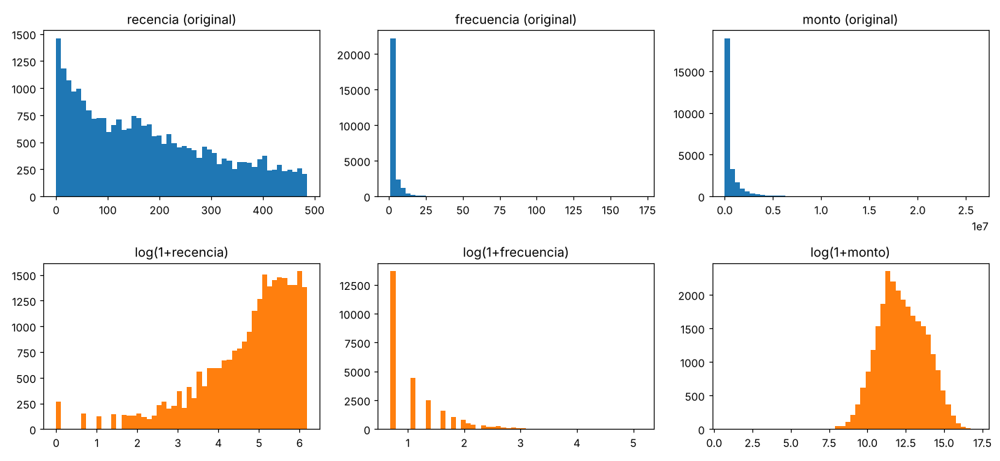

# Foro — Kaggle: Datos compartidos

> Respuesta publicada en el campus (Minería de Datos, Semana 7). Caso real: base de clientes de comercio minorista (sin nombre de empresa; la base no se incluye en el repositorio).
> **Rúbrica:** participación 40 % · calidad de las aportaciones 20 % · interacción 10 % · uso de fuentes 10 % · gramática 10 % · redacción 10 %.
> Código y cifras: [`codigo/analisis_rfm.py`](../codigo/analisis_rfm.py) · [notebook UD7, sección 9](../notebooks/UD07-Clustering.md)

---

**¿Has abordado alguna vez la limpieza de datos en algún dataset específico de Kaggle?**

No he trabajado con un dataset de Kaggle. Sí he hecho limpieza con una base real de 26.759 clientes de comercio minorista (ID, fechas de primera y última compra, días desde la última compra, número de compras y monto total), y creo que el proceso es el mismo que se ve en esos datasets.

Lo que encontré y cómo lo resolví:
- **Formato:** el monto venía como texto con el símbolo "$" y las fechas como texto. Los convertí a número y fecha. El encabezado traía un carácter invisible que impedía leer la primera columna.
- **IDs mal formados:** 5 clientes tenían un ID imposible, por ejemplo un marcador repetido (1111111111111) o dos números pegados. Los excluí.
- **Montos en cero:** 63 clientes tenían entre 1 y 8 compras con monto 0. No pude confirmar la causa (devolución, promoción), así que los retiré del análisis de monto.
- **Consistencia:** verifiqué que los días desde la última compra coincidieran con la fecha de corte y que ninguna primera compra fuera posterior a la última. Todo cuadró.

Quedaron 26.691 clientes. Esta revisión sigue la idea de datos ordenados de Wickham (2014): cada variable en una columna y cada cliente en una fila.

📌 **Notas:**
- *Carácter invisible (BOM):* una marca oculta al inicio de algunos archivos de texto. Hace que el nombre de la primera columna se lea mal.
- *Fecha de corte:* el día hasta el cual se miden las compras. Los "días desde la última compra" se cuentan hasta esa fecha.

---

**Comparte tu experiencia resolviendo una competición de Kaggle. ¿Qué metodologías utilizaste?**

No he participado en una competición de Kaggle. Lo que sí puedo compartir es la metodología que seguí en un proyecto de segmentación de clientes, que es muy parecida al flujo de una competición:

1. **Variables RFM:** recencia (días desde la última compra), frecuencia (número de compras) y monto, un esquema clásico para analizar clientes (Fader et al., 2005).
2. **Transformar y estandarizar:** la frecuencia y el monto estaban muy sesgados (el 51 % compró una sola vez; un cliente llegó a 171 compras). Apliqué logaritmo y estandaricé para que ninguna variable dominara las distancias.
3. **Línea base primero:** K-Means, probando varios valores de k.
4. **Validar:** silhouette para comparar valores de k (Rousseeuw, 1987) y estabilidad con otras semillas usando ARI (Hubert & Arabie, 1985): obtuve entre 0.875 y 0.997.
5. **Interpretar:** elegí k=4 por criterio de negocio.

Una diferencia con Kaggle: aquí **no hay tabla de posiciones**, porque no existe una respuesta correcta que predecir. El silhouette fue bajo (0.33 con k=4), lo que indica que los clientes forman un continuo y no grupos naturales. Por eso la segmentación se valida con estabilidad y utilidad para el negocio.

📌 **Notas para seguir el texto:**
- **RFM:** *Recency* (qué tan reciente compró), *Frequency* (cuántas veces compró) y *Monetary* (cuánto gastó). Tres números por cliente.
- **K-Means y k:** K-Means es un algoritmo que agrupa clientes parecidos. **k** es el número de grupos que le pedimos.
- **Sesgo y logaritmo:** hay sesgo cuando casi todos los valores son pequeños y unos pocos son enormes. El logaritmo "comprime" esos valores grandes para que no dominen.
- **Estandarizar:** poner las variables en una escala comparable (por ejemplo, días y dinero), para que la de mayor magnitud no pese más.
- **Silhouette:** mide qué tan bien quedó cada cliente dentro de su grupo, comparando su cercanía con los de su grupo frente a los del grupo vecino. Va de −1 a 1.
  - Cerca de **1**: grupos compactos y bien separados.
  - Cerca de **0**: los grupos se traslapan.
  - **Negativo**: el cliente probablemente está en el grupo equivocado.
  - Se calcula con varios k y se elige, entre otros criterios, el que da el valor más alto. Mi 0.33 es un valor bajo: los grupos se traslapan.
- **ARI (Índice de Rand ajustado):** compara dos agrupaciones del mismo conjunto de clientes. Cuenta los pares de clientes que ambas agrupaciones tratan igual, es decir, juntos en las dos o separados en las dos, y descuenta lo que se esperaría por azar. Va de 0 a 1 (aunque puede ser negativo si es peor que el azar).
  - **1**: las dos agrupaciones son idénticas.
  - **Cerca de 0**: el parecido es el que se esperaría por azar.
  - Aquí lo usé para ver si, al repetir K-Means con otra semilla, los grupos se mantenían: un ARI de 0.875 a 0.997 indica que los segmentos son **estables**.
- **Semilla:** el número con el que se fija el arranque aleatorio del algoritmo. Cambiarla es una forma de comprobar si el resultado depende del azar.
- **Línea base:** el primer modelo, simple, contra el cual se comparan los demás.
- **Continuo:** datos sin cortes naturales; los clientes pasan poco a poco de unos a otros, sin "islas" claras.

---

**¿Podrías describir un caso en el que hayas usado una técnica de visualización específica para mejorar el análisis en Kaggle?**

No en Kaggle, pero sí con la base de clientes. Usé **histogramas antes y después de aplicar logaritmo** a la recencia, la frecuencia y el monto.

- En la versión original, la frecuencia y el monto tenían una cola larguísima: casi todos los clientes quedaban amontonados cerca de cero y unos pocos muy lejos. Con ese sesgo, K-Means se deja arrastrar por los casos extremos.
- Tras el logaritmo, las distribuciones se ven más equilibradas y los segmentos son más interpretables.

Gracias a esa visualización la decisión de transformar no fue una intuición, sino algo que se vio en los datos. Con k=4 los segmentos fueron: **mejores** (13,5 %; mediana de 8 compras), **regulares** (25,8 %; 3 compras), **nuevos u ocasionales** (34,0 %; 1 compra reciente) y **dormidos** (26,7 %; 1 compra, hace unos 350 días).

📌 **Notas:**
- *Histograma:* un gráfico de barras que muestra cuántos clientes caen en cada rango de valores. Permite ver si la mayoría está amontonada o repartida.
- *Cola larga:* pocos valores muy grandes que estiran el gráfico hacia un lado.
- *Mediana:* el valor del medio cuando se ordenan los datos. Se usa en lugar del promedio porque los clientes con valores extremos distorsionan el promedio.

**Para debatir:** ¿cómo eligen k cuando el silhouette es bajo y los datos parecen un continuo, como en RFM? ¿Priorizan la métrica o la utilidad para el negocio?

---

## Referencias (APA 7)

Fader, P. S., Hardie, B. G. S., & Lee, K. L. (2005). RFM and CLV: Using iso-value curves for customer base analysis. *Journal of Marketing Research, 42*(4), 415–430.

Hubert, L., & Arabie, P. (1985). Comparing partitions. *Journal of Classification, 2*(1), 193–218. https://doi.org/10.1007/BF01908075

Rousseeuw, P. J. (1987). Silhouettes: A graphical aid to the interpretation and validation of cluster analysis. *Journal of Computational and Applied Mathematics, 20*, 53–65. https://doi.org/10.1016/0377-0427(87)90125-7

Wickham, H. (2014). Tidy data. *Journal of Statistical Software, 59*(10), 1–23. https://doi.org/10.18637/jss.v059.i10

> **Pendiente de verificar en la fuente:** volumen, número y páginas de Fader et al. (2005) y páginas de Wickham (2014).
