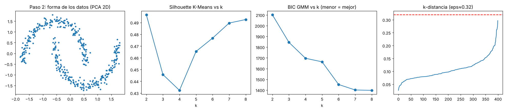

# UD07 · Extracción de estructura de los datos: Clustering — Minería de Datos (T3)

> **Fuentes:** guía académica de la unidad (20 pp.), Recursos y Bibliografía de la asignatura, y artículos académicos verificados (sección Referencias).
> **Convención:** **[guía]** = sale de la guía de la unidad · **[complemento]** = fuente externa o práctica habitual de ciencia de datos · **[propio]** = prueba que ejecuté yo.
> **Nota de nombre:** el campus titula la unidad "Extracción de estructura de los datos, Clustering". El README previo la listaba como "Deeplearning" y ubicaba clustering en la UD9; confirmar.

---

## 1. Resumen ejecutivo

- **Clustering** = agrupar datos **sin etiquetas** (aprendizaje no supervisado) **[guía]**.
- Cinco algoritmos: K-Means, Mean-Shift, DBSCAN, GMM (EM) y jerárquico aglomerativo **[guía]**.
- **La forma de los datos decide el algoritmo:** redondos → K-Means; elípticos/traslapados → GMM; irregulares o con atípicos → DBSCAN.
- Se evalúa con **silhouette** (sin etiquetas) y se compara con **ARI** solo cuando existe una referencia.
- **Playbook:** un paso a paso + una función en Python que diagnostica los datos y sugiere el algoritmo inicial.

## 2. Ruta de estudio

1. Qué es clustering → 2. Los 5 algoritmos → 3. Conceptos clave (silhouette, semilla, ARI) → 4. Playbook paso a paso → 5. Código probado → 6. Aplicación a BI → 7. Preguntas corregidas → 8. Referencias

## 3. Clustering en pocas palabras

🟢 **Simple:** el algoritmo junta los puntos parecidos y separa los distintos, sin que nadie le diga cuáles son los grupos.
🔵 **Técnico:** los puntos de un mismo grupo deben tener propiedades similares y los de grupos distintos, propiedades muy diferentes **[guía]**. Jain (2010) ofrece una revisión general de los algoritmos de clustering y de sus retos **[complemento]**.
💡 **BI:** segmentar clientes por frecuencia y ticket sin saber de antemano cuántos tipos hay.

## 4. Los 5 algoritmos

| Algoritmo | Cómo funciona | Ventaja | Limitación |
|---|---|---|---|
| **K-Means** | Eliges k; centros al azar; cada punto va al centro más cercano; se recalcula con la media; se repite **[guía]** | Rápido (complejidad lineal) | Hay que fijar k; el azar inicial cambia resultados; grupos redondos |
| **Mean-Shift** | Una ventana se desplaza hacia la zona más densa (Comaniciu & Meer, 2002) **[guía + complemento]** | No necesita k | Elegir el radio de la ventana |
| **DBSCAN** | Un punto con suficientes vecinos (minPoints) dentro de ε inicia un grupo; los demás son ruido. Ester et al. (1996) lo plantean como un método que usa la densidad para distinguir grupos de ruido y encuentra grupos de forma arbitraria | No necesita k; marca atípicos como ruido | Densidades distintas; muchas dimensiones **[guía]** |
| **GMM / EM** | Cada grupo es una gaussiana; calcula la probabilidad de pertenecer a cada una **[guía]** | Grupos elípticos; asignación mixta | Hay que fijar el nº de grupos |
| **Jerárquico aglomerativo** | Cada punto empieza solo y se funden los grupos más cercanos; dendrograma **[guía]** | No requiere k de antemano | Lento, O(n³) según la guía |

⚠️ **Simplificaciones de la guía:**
1. "K-Means es un caso especial de GMM con covarianza → 0": lo preciso es que con grupos esféricos de igual varianza y asignación dura, GMM se comporta como K-Means.
2. "El jerárquico no es sensible a la métrica": el tipo de enlace (promedio, completo, Ward) sí cambia el resultado.

## 5. Conceptos clave

### 5.1 Silhouette (para elegir k)
Para cada punto: **a** = distancia media a su propio grupo; **b** = distancia media al grupo vecino más cercano; **s = (b − a) / max(a, b)** (idea de Rousseeuw, 1987; ver también su uso en scikit-learn, Pedregosa et al., 2011).
- Cerca de **1**: grupos compactos y separados. Cerca de **0**: se traslapan. **Negativo**: probablemente mal asignado.
- Se prueban varios k y se mira el **promedio más alto**. Ejemplo: a=2, b=8 → s=(8−2)/8=0.75.
- Cuidado: favorece grupos redondos y no sustituye el criterio de negocio.

### 5.2 La semilla (`random_state=42`)
Es el punto de partida del generador pseudoaleatorio. Misma semilla → mismos centros iniciales → mismo resultado (**reproducibilidad**). El 42 es una convención; sirve cualquier número. **No mejora el modelo.** Quien reduce el riesgo de una mala solución es `n_init=10` (10 arranques y se queda con el mejor). Buena práctica: probar otras semillas y comprobar estabilidad.

### 5.3 ARI (Adjusted Rand Index)
Compara dos agrupaciones contando pares de puntos en que coinciden (juntos en ambas o separados en ambas), corregido por azar (Hubert & Arabie, 1985). **1** = idéntica; **≈0** = azar; **negativo** = peor que el azar. **Necesita etiquetas de referencia**, que en la vida real normalmente no existen; por eso se usa en demos y pruebas sintéticas.

### 5.4 Las lunas
Dos medias lunas entrelazadas. K-Means corta con una recta entre centros y mezcla los puntos (ARI 0.234 **[propio]**); DBSCAN sigue la densidad y las separa (ARI 1.0 **[propio]**).

## 6. Demo base (ejecutada) **[propio]**

| Prueba | Resultado |
|---|---|
| K-Means k=3: silhouette / ARI | 0.773 / 0.99 |
| Silhouette k=2,3,4,5 | 0.636 / **0.773** / 0.701 / 0.607 |
| K-Means `n_init=1`, 6 semillas (inercia) | 226.0, 225.9, 225.9, 49.1, 49.1, 49.1 |
| Mean-Shift (radio 0.47) | 4 grupos (ARI 0.971): el radio importa |
| GMM / jerárquico (ARI) | 1.0 / 1.0 |
| Lunas: K-Means vs DBSCAN (ARI) | 0.234 vs 1.0 |
| DBSCAN con 2 atípicos añadidos | ambos como ruido (-1) |

## 7. 🧭 PLAYBOOK: de los datos al algoritmo

### Paso 0 · Definir el objetivo
¿Qué decisión apoya el agrupamiento? ¿Qué es una fila (cliente, producto, transacción)? Define si necesitas probabilidades (GMM), jerarquía (dendrograma) o aislar atípicos (DBSCAN).

### Paso 1 · Preparar los datos
| Qué revisar | Qué hacer |
|---|---|
| Tipos, nulos, duplicados | Quitar o imputar; una fila = una entidad |
| Variables muy sesgadas (tickets, montos) | Transformar (por ejemplo, logaritmo) **[complemento]** |
| Variables categóricas | K-Means y similares usan distancias: codificar con cuidado o usar medidas para datos mixtos **[complemento]** |
| Escalas distintas | **Estandarizar** siempre (la variable de mayor escala domina la distancia) |
| Variables redundantes (correlación alta) | Quitar o reducir con PCA |

### Paso 2 · Explorar y graficar
1. `describe()` e histogramas por variable (escala, sesgo).
2. Mapa de correlaciones.
3. Diagrama de caja (atípicos).
4. **Dispersión de pares o PCA a 2D:** ¿se ven grupos? ¿de qué forma? (primer gráfico del playbook).

### Paso 3 · Diagnosticar la forma (las 6 preguntas)
| Pregunta | Si la respuesta es… | Apunta a |
|---|---|---|
| ¿Grupos redondos y de tamaño similar? | Sí | K-Means |
| ¿Elípticos o traslapados? ¿Quiero probabilidades? | Sí | GMM |
| ¿Formas irregulares (lunas, anillos)? | Sí | DBSCAN |
| ¿Hay atípicos o ruido? | Sí | DBSCAN (o retirar atípicos y usar K-Means) |
| ¿Densidades muy distintas entre grupos? | Sí | Evitar DBSCAN simple; probar GMM o jerárquico |
| ¿Muchas dimensiones? | Sí | Reducir antes (PCA) y luego agrupar |

### Paso 4 · Elegir candidatos
Siempre **K-Means como línea base**, más el algoritmo que apunte el diagnóstico. Compara 2 o 3 y no te quedes con uno solo.

### Paso 5 · Elegir parámetros
- **K-Means:** silhouette vs k (y el codo de la inercia).
- **GMM:** BIC vs k (menor es mejor) **[complemento]**.
- **DBSCAN:** `min_samples` ≈ 2×dimensiones como punto de partida (Schubert et al., 2017) **[verificar en la fuente]** y ε con la gráfica de distancias al k-ésimo vecino.
- **Mean-Shift:** radio con `estimate_bandwidth`.
- **Jerárquico:** dendrograma.

### Paso 6 · Validar
1. **Estabilidad:** otras semillas y submuestras; si los grupos cambian mucho, no son confiables.
2. **Silhouette** del modelo elegido.
3. **Perfil de cada grupo:** promedios por segmento; ¿puedes describirlos y actuar sobre ellos?
4. **Criterio de negocio** (decide el k final).

### Paso 7 · Documentar
Datos usados, transformaciones, algoritmo, parámetros, métricas y por qué se descartaron las demás opciones.

## 8. Código del playbook (probado) **[propio]**

Archivo completo: `codigo/playbook_clustering.py`. Uso:

```python
from playbook_clustering import diagnostico_clustering
res = diagnostico_clustering(df, cols=["frecuencia","ticket","meses_activo"], grafico="diagnostico.png")
print(res["recomendacion"]); print(res["razones"][0])
```

**Qué hace:** (1) estandariza; (2) calcula atípicos, asimetría y correlación máxima; (3) prueba K-Means (silhouette) y GMM (BIC) para varios k; (4) busca un ε estable para DBSCAN; (5) mide si los grupos son **convexos** (qué porcentaje de puntos de otros grupos cae dentro de la envolvente de un grupo, en 2D con PCA); (6) decide con reglas:

1. Grupos no convexos (>5 % de solape) → **DBSCAN**.
2. DBSCAN marca ≥2 % de ruido y, fuera de ellos, coincide con K-Means (ARI ≥ 0.9) → **atípicos** → DBSCAN o K-Means tras retirarlos.
3. Convexos pero K-Means y GMM discrepan (ARI < 0.8) → **GMM**.
4. Si no → **K-Means**.

Guarda además 4 gráficos: forma de los datos (PCA 2D), silhouette vs k, BIC vs k y la curva de k-distancia.

### Resultados de la prueba

| Conjunto (400 filas) | Recomendación | Observación |
|---|---|---|
| Bloques (3 segmentos) | **K-Means** (silhouette 0.78, k=3) | 10/10 semillas |
| Lunas | **DBSCAN** (18 % de solape convexo, 2 grupos) | 10/10 semillas |
| Bloques + atípicos | **DBSCAN o K-Means sin atípicos** | 10/10 semillas |
| Elipses alargadas | **GMM** en 4 de 10 semillas, K-Means en 5, alerta de atípicos en 1 | Ver límites |



### Límites (importante)
- Es una **heurística inicial**, no un oráculo. Los umbrales (5 %, 2 %, 0.9, 0.8) son decisiones mías, ajustadas con datos sintéticos de 2 dimensiones.
- En elipses bien separadas K-Means también funciona, y la función lo reconoce; en elipses traslapadas recomienda GMM. En una de diez semillas dio una falsa alarma de atípicos.
- La convexidad se mide en una proyección 2D (PCA): con muchas dimensiones puede subestimar el solape.
- No reemplaza los pasos 6 y 7 (validar con el negocio y documentar).
- Probado con datos sintéticos y con una base real (sección 9): ahí la heurística recomendó DBSCAN, pero los clientes forman un continuo y se eligió K-Means por criterio de negocio. **Con datos reales la recomendación es un punto de partida, no una decisión.**

## 9. Caso real: segmentación RFM de clientes **[propio]**

Base real de **26.759 clientes de comercio minorista** (ID, fechas de primera y última compra, días desde la última compra, número de compras y monto total). Se usó en el Foro de la semana ([ver respuesta](../foros/Foro-UD7-Kaggle-Datos-Compartidos.md)). **La base no se incluye en el repositorio** porque contiene identificadores de clientes. Código: `codigo/analisis_rfm.py`.

### 9.1 Limpieza (Paso 1 del playbook)
| Hallazgo | Decisión |
|---|---|
| Encabezado con carácter invisible (BOM); monto como texto con "$"; fechas como texto | Leer con `utf-8-sig`; convertir a número y fecha |
| 5 IDs mal formados (marcador `1111111111111`, dos de 20 dígitos) | Excluir |
| 63 clientes con monto 0 (1 a 8 compras) | Excluir del análisis (causa no confirmada) |
| Recencia coherente con la fecha de corte; ninguna primera compra posterior a la última | Sin acción |
| Asimetría: F = 7.14, M = 4.91; el 51 % compró una vez; máximo 171 compras | Logaritmo en F y M |
Resultado: **26.691 clientes**.

### 9.2 Exploración y visualización (Paso 2)


Sin transformar, F y M tienen una cola larguísima que arrastra a K-Means; con el logaritmo las distribuciones son más equilibradas.

### 9.3 Diagnóstico, k y validación (Pasos 3 a 6)
- **Playbook** (sobre los datos con logaritmo): recomendó **DBSCAN** (32 % de solape convexo; 3 grupos; 0,1 % de ruido).
- **Silhouette** (muestra de 6.000): k=2: 0.399 · k=3: 0.371 · **k=4: 0.332** · k=5: 0.329 · k=6: 0.302 · k=7: 0.309. Son valores bajos: los clientes forman un **continuo**, no grupos naturales. (Sin logaritmo el máximo fue 0.639 en k=2, pero esos valores no son comparables entre transformaciones.)
- **Decisión:** K-Means con **k=4** por criterio de negocio (4 perfiles accionables), no por el mayor silhouette ni por la recomendación del playbook.
- **Estabilidad (ARI con otras semillas):** 0.875, 0.923 y 0.997.

| Segmento | % | Recencia (mediana) | Frecuencia | Monto |
|---|---|---|---|---|
| Mejores | 13,5 | 78 días | 8 | ~2,0 M |
| Regulares | 25,8 | 105 | 3 | ~556 mil |
| Nuevos u ocasionales | 34,0 | 107 | 1 | ~79 mil |
| Dormidos | 26,7 | 352 | 1 | ~96 mil |

**Lección:** en datos RFM la segmentación es una **partición útil**, no un hallazgo de grupos "reales". Se valida con estabilidad y utilidad para el negocio.

### 9.4 Referencias del caso
RFM como esquema de análisis de clientes: Fader et al. (2005). Datos ordenados: Wickham (2014).

## 10. R (no probado, R no está disponible en mi entorno)

```r
set.seed(42)
d  <- scale(iris[,1:4])
km <- kmeans(d, centers = 3, nstart = 10)
hc <- hclust(dist(d), method = "average"); plot(hc)
library(dbscan); db <- dbscan(d, eps = 0.9, minPts = 5)
library(mclust); gm <- Mclust(d, G = 3)
```

## 11. Aplicación real (BI)

Tabla de clientes (frecuencia, ticket promedio, meses activos): aplicar el playbook, estandarizar (y transformar el ticket si está sesgado), ejecutar el diagnóstico, escribir el segmento como una columna en Snowflake y consumirlo en Power BI. Revisar el perfil de cada segmento con el área comercial antes de usarlo.

## 12. Preguntas de comprensión (corregidas)

**1. Antes de K-Means:** estandarizar (porque usa distancias y la variable de mayor escala domina), hacer EDA y **validar** k con silhouette y criterio de negocio. Dos corridas pueden diferir por los centros iniciales aleatorios: `n_init` mejora la solución y `random_state` la hace reproducible.
**2. Formas irregulares y atípicos:** DBSCAN (grupos de forma libre, atípicos como ruido). K-Means para grupos compactos, redondos y de tamaño similar. DBSCAN falla con densidades muy distintas.
**3. GMM vs K-Means:** GMM asigna **probabilidades** (por ejemplo, 60 % "regular" y 40 % "fiel"), admite grupos elípticos y maneja mejor el traslape; K-Means da una asignación dura.

## 🧠 Lo que debes recordar

1. Clustering = agrupar sin etiquetas.
2. **Estandariza** antes de agrupar; valida k con silhouette **y** negocio.
3. `n_init` mejora la solución; `random_state` la hace reproducible (42 no tiene nada especial).
4. Silhouette: cerca de 1 = bien separado; ≈0 = traslape; negativo = mal asignado.
5. ARI necesita etiquetas de referencia: sirve para demos, no para el día a día.
6. K-Means: redondos. GMM: elípticos y probabilidades. DBSCAN: formas libres y ruido. Mean-Shift: sin k, ojo con el radio. Jerárquico: dendrograma, lento.
7. **El diagnóstico va antes del algoritmo:** mira la forma, los atípicos y la densidad; compara 2 o 3 candidatos; valida y documenta.

## Referencias (APA 7)

Comaniciu, D., & Meer, P. (2002). Mean shift: A robust approach toward feature space analysis. *IEEE Transactions on Pattern Analysis and Machine Intelligence, 24*(5), 603–619. https://doi.org/10.1109/34.1000236

Ester, M., Kriegel, H.-P., Sander, J., & Xu, X. (1996). A density-based algorithm for discovering clusters in large spatial databases with noise. En *Proceedings of the Second International Conference on Knowledge Discovery and Data Mining (KDD-96)* (pp. 226–231).

Hubert, L., & Arabie, P. (1985). Comparing partitions. *Journal of Classification, 2*(1), 193–218. https://doi.org/10.1007/BF01908075

Jain, A. K. (2010). Data clustering: 50 years beyond K-means. *Pattern Recognition Letters, 31*(8), 651–666. https://doi.org/10.1016/j.patrec.2009.09.011

Fader, P. S., Hardie, B. G. S., & Lee, K. L. (2005). RFM and CLV: Using iso-value curves for customer base analysis. *Journal of Marketing Research, 42*(4), 415–430.

Pedregosa, F., Varoquaux, G., Gramfort, A., Michel, V., Thirion, B., Grisel, O., Blondel, M., Prettenhofer, P., Weiss, R., Dubourg, V., Vanderplas, J., Passos, A., Cournapeau, D., Brucher, M., Perrot, M., & Duchesnay, É. (2011). Scikit-learn: Machine learning in Python. *Journal of Machine Learning Research, 12*, 2825–2830.

Rousseeuw, P. J. (1987). Silhouettes: A graphical aid to the interpretation and validation of cluster analysis. *Journal of Computational and Applied Mathematics, 20*, 53–65. https://doi.org/10.1016/0377-0427(87)90125-7

Schubert, E., Sander, J., Ester, M., Kriegel, H.-P., & Xu, X. (2017). DBSCAN revisited, revisited: Why and how you should (still) use DBSCAN. *ACM Transactions on Database Systems, 42*(3), Artículo 19. https://doi.org/10.1145/3068335

Universidad DaVinci. (s. f.). *Extracción de estructura de los datos, Clustering* [Guía académica, Unidad 7]. Minería de Datos. LMS UDaVinci. https://lms.udavinci.edu.mx

Wickham, H. (2014). Tidy data. *Journal of Statistical Software, 59*(10), 1–23. https://doi.org/10.18637/jss.v059.i10

*Bibliografía de la asignatura para ampliar (no leída en esta sesión):* Alpaydin (2021); Bobadilla (2021); Zhou (2021).

> **Pendiente de verificar:** volumen, número y páginas de Fader et al. (2005) y páginas de Wickham (2014) (no confirmadas en la fuente).
>
> **Verificación de fuentes:** de los artículos citados, confirmé autores, año, revista, volumen y páginas (o proceedings). Las afirmaciones que les atribuyo son generales (qué propone cada trabajo). El detalle de la regla de `min_samples` en Schubert et al. (2017) y el uso de la silhouette en Pedregosa et al. (2011) deben confirmarse leyendo la fuente antes de citarlos en una entrega.
